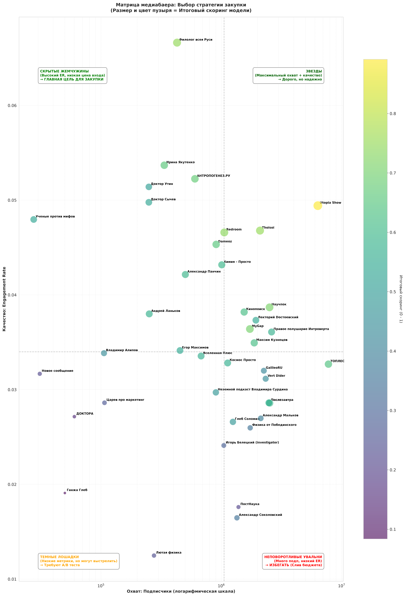

# YouTube Channel Scoring для медиабаинга

## 📌 Краткое резюме (TL;DR)
Проект помогает медиабаерам выбирать YouTube-каналы для рекламных закупок не «по количеству подписчиков», а на основе качества аудитории и предсказуемости охвата. Модель оценивает вовлечённость (ER), динамику просмотров и стабильность. Главный вывод: **размер канала не предсказывает вовлечённость**, поэтому закупка «по подписчикам» ведёт к переплате. Итоговый скоринг и BCG-матрица позволяют перераспределить бюджет в пользу «скрытых жемчужин».

## 💡 Ключевой вывод проекта

Анализ 40 YouTube-каналов показал, что **размер канала не предсказывает вовлечённость (Spearman ρ=−0.11, p=0.49)**. 
Каналы-«жемчужины» (Филолог всея Руси, Ирина Якутенко, Ученые против мифов) имеют в 2-15 раз меньше подписчиков, 
чем «звёзды» (Utopia Show, Redroom), но **превосходят их по ER в 1.3–1.4 раза**. 

Это значит: закупка «по подписчикам» переплачивает за охват и недополучает вовлечённость. 
Модель скоринга и BCG-матрица помогают перераспределить бюджет в пользу «скрытых жемчужин».

## Проблема
Медиабаеры часто выбирают каналы по размеру аудитории. Но большой канал не гарантирует высокий ER, предсказуемый охват и эффективную стоимость вовлечения. Бюджет может уйти на канал с пассивной аудиторией или нестабильными просмотрами.

## Что делает проект
- Выгружает статистику по 40 YouTube-каналам и их видео через YouTube Data API v3.
- Очищает данные и исключает Shorts, чтобы не смешивать разные механики потребления контента.
- Считает метрики на уровне канала: медианный ER, просмотры в день, стабильность просмотров.
- Проверяет две гипотезы:
  1. Влияет ли размер канала на Engagement Rate?
  2. Влияет ли длительность видео на Engagement Rate?
- Строит итоговый скоринг каналов и BCG-матрицу для медиабаера.

## Методология
- **ER** считается как `(likes + comments) / views`, затем агрегируется по медиане на уровне канала.
- **Shorts исключены**, потому что их механика отличается от длинных видео (медианный ER Shorts 1.83% против 3.32%).
- **Стабильность** считается как `1 - CV(log1p(views_per_day))`: чем ниже разброс, тем предсказуемее следующий выпуск.
- Для проверки H2 используется OLS с фиксированными эффектами канала и кластеризованными ошибками.

## Результаты проверки гипотез
| Гипотеза | Метод | Результат |
|---|---|---|
| H1: размер канала влияет на ER | Spearman + Kruskal-Wallis | Не подтверждена: ρ=-0.11, p=0.49; KW p=0.59 |
| H2: длительность видео влияет на ER | OLS + channel FE | Не подтверждена: p≈0.11, 95% ДИ включает 0 |

Корректный вывод: **на этих данных статистически значимой связи не найдено**. Это не доказывает отсутствие связи, но показывает, что ER и размер канала несут независимый сигнал.

## Веса скоринговой модели
| Признак | Вес | Зачем |
|---|---:|---|
| ER | 50% | Прямой индикатор живой аудитории |
| Подписчики | 20% | Базовый охват медиаплана |
| Просмотры/день | 15% | Ловит каналы «на подъёме» и отсекает мёртвых гигантов |
| Стабильность `1-CV` | 15% | Штрафует непредсказуемый охват |

## BCG-матрица медиабаера


- **Скрытые жемчужины** — высокий ER при небольшом охвате.
- **Звёзды** — большой охват + качество.
- **Тёмные лошадки** — низкие метрики, но потенциальный рост.
- **Неповоротливые увальни** — много подписчиков, низкий ER; избегать.

## Структура проекта
```text
.
├── data/               # Исходные выгруженные данные
├── notebooks/          # Ноутбуки с парсингом и аналитикой
├── reports/            # Итоговые таблицы и графики
├── requirements.txt
├── README.md
└── .gitignore


## 🚀 Как запустить проект

1. **Клонируйте репозиторий:**
   ```bash
   git clone https://github.com/Arkwark/youtube-channel-scoring.git
   cd youtube-channel-scoring
   ```
2. **Настройте переменные окружения:**
   Убедитесь, что в корне проекта есть файл `.env` с вашим ключом (файл уже должен существовать локально; в Git он не попадает):
   ```text
   YOUTUBE_API_KEY=ваш_ключ_из_google_cloud_console
   ```
3. **Установите зависимости:**
   ```bash
   python -m pip install -r requirements.txt
   ```
4. **Запустите ноутбуки по порядку:**
   * `notebooks/01_data_extraction.ipynb` — собирает данные через API.
   * `notebooks/02_channel_scoring.ipynb` — проводит анализ, проверяет гипотезы и строит графики.
